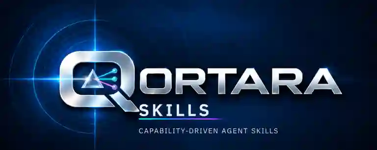

# Qortara Skills

**A zero-inference-token agent-skill builder for the Qortara family.**

Qortara Skills is a **proposed**, evidence-driven compiler for portable AI-agent skills. It is designed to turn explicit capability requirements and eligible, version-pinned source material into reproducible skill packages, with clear refusals when the evidence, rights, or coverage are insufficient.

> **Project state: Foundation / pre-implementation.** The source-documentation foundation was merged in [PR #2](https://github.com/MythologIQ-Labs-LLC/skill-mason/pull/2). Confidential security intake and native Qortara qualification remain **on hold** ([issue #4](https://github.com/MythologIQ-Labs-LLC/skill-mason/issues/4)). **No working skill-generation CLI, Prism application integration, published release, or behaviorally validated generated skill exists yet.** The zero-inference-token objective is a design requirement, not a measured claim.

[Brand icon](assets/brand/qortara-skills-icon.webp) · [Product requirements](docs/PRD.md) · [Architecture](docs/architecture/skill-mason-pipeline-v0.md) · [Governance](GOVERNANCE.md) · [Current work](https://github.com/MythologIQ-Labs-LLC/skill-mason/issues/1)

---

## Contents

- [Why Qortara Skills exists](#why-qortara-skills-exists)
- [What it will do](#what-it-will-do)
- [How the pieces fit together](#how-the-pieces-fit-together)
- [The zero-inference-token contract](#the-zero-inference-token-contract)
- [Capability model and output](#capability-model-and-output)
- [Trust, security, and refusals](#trust-security-and-refusals)
- [Project status and roadmap](#project-status-and-roadmap)
- [Explore the repository](#explore-the-repository)
- [Develop and validate](#develop-and-validate)
- [Repository governance](#repository-governance)
- [Frequently asked questions](#frequently-asked-questions)
- [Contributions and licensing](#contributions-and-licensing)

## Why Qortara Skills exists

Finding a skill is not the same as having a skill an agent can safely and effectively use.

A catalog may identify hundreds of promising procedures, but a specific task still needs reliable answers: **What outcome must the agent achieve? Which method actually covers it? May that source be reused? Which tools, permissions, data, and host features are required? What has been tested?**

[skillz](https://github.com/Knapp-Kevin/skillz) is growing into a broad, curated capability library across disciplines. Qortara Skills is its **separate downstream engineering project**. Instead of treating discovery counts as finished capabilities, Qortara Skills aims to assemble methods only when the requested outcome and its constraints can be supported.

The goal is not to manufacture impressive-looking `SKILL.md` files. It is to produce **small, traceable, fit-for-purpose skills**, or explain precisely why one cannot yet be produced.

### Who it is for

| Audience | Intended value |
| --- | --- |
| Agent users | A relevant skill matched to a concrete outcome, with clear limitations |
| Solo developers and teams | Reproducible packages that are easier to review, compare, and update |
| Skill maintainers | Provenance, dependency and rights boundaries retained across composition |
| Security and governance reviewers | Explicit authority limits, refusals, and evidence that can be checked independently |
| Host and tool builders | A future versioned recipe, artifact, and verification contract rather than opaque prompts |

## What it will do

The planned compiler has six responsibilities:

1. **Understand the requested outcome.** Identify the domain, subdomain, specific capability, essential workflow, target host, and permitted authority.
2. **Read a pinned catalog snapshot.** Inspect exact source identities and evidence supplied through an approved, read-only adapter. An unindexed capability is **unknown**, not necessarily absent.
3. **Qualify possible building blocks.** Check fit, rights (including nested assets), source freshness, package security, dependencies, portability, and permitted side effects independently.
4. **Choose and compose deterministically.** Assemble eligible methods using declared rules, templates, and parameters. Refuse an essential outcome that cannot be represented faithfully.
5. **Produce inspectable artifacts.** Emit a portable skill, provenance and source manifest, decision trace, verification status, and reproducible digests.
6. **Support separate behavioral qualification.** A consuming host can later run authorized sandbox tests. Passing a compiler check never means the skill actually worked in that host.

These are **requirements, not shipped capabilities**. The definitive scope and first-pilot acceptance criteria live in the [PRD](docs/PRD.md) and [acceptance matrix](docs/ACCEPTANCE.md).

### What it will not do

Qortara Skills will not silently copy an entire third-party corpus, treat a popular skill as safe, infer reuse rights from a repository badge, execute commands found in candidate text, grant itself permissions, install packages without approval, or invent missing expertise. New method authorship may eventually be supported through an **explicitly separate** process; it is not part of the zero-inference build.

## How the pieces fit together

| System | Owns | Does **not** authorize |
| --- | --- | --- |
| [skillz](https://github.com/Knapp-Kevin/skillz) | Passive discovery, taxonomy, source versions, reviews, and qualification leads | Automatically reusing or executing discovered methods |
| **Qortara Skills** | Planned selection, eligibility decisions, deterministic assembly, and artifact receipts | Rewriting upstream assessments or activating output in a host |
| [UOR Prism](https://github.com/UOR-Foundation/prism) | Candidate typed computation and replay-verification foundation | Claims about external task success without observed evidence |
| **Consuming agent / authorized host** | Actual installation, execution, credentials, and observed use | Treating compiled text as permission to bypass host policy |

```text
  USER / HOST REQUEST
  outcome + target + permitted authority
                 |
                 v
  skillz: pinned capability evidence (read only)
                 |
                 v
  [Catalog adapter] -> [Eligibility and coverage gates]
                                 |            |
                               refuse       eligible
                                              |
                                              v
                              [Deterministic skill composer]
                                              |
                                              v
                            [Verification and replay]  (planned)
                                              |
                                              v
                          SKILL.md + sources + receipt + hashes
                                              |
                                      user/host approval
                                              |
                                              v
                            optional, separate behavioral test
```

**Prism feasibility remains open, with first evidence.** The verified-application route using the [UOR template](https://github.com/UOR-Foundation/template) was executed on 2026-11-17: its reference application passed its complete gate, and one candidate eligibility decision was built and verified in a rebuilt instance ([evidence](docs/evidence/prism-phase0-20261117/README.md)). Nothing is adopted: Qortara Skills is not a Prism-built application until the owner accepts [ADR-0003](docs/adr/0003-prism-application-adoption.md). See [RFC-0001](docs/RFC-0001-prism-feasibility.md) and [issue #3](https://github.com/MythologIQ-Labs-LLC/skill-mason/issues/3).

## The zero-inference-token contract

**Zero inference tokens at build time** means the deterministic assembly path makes **zero LLM inference calls**. It is a measurable execution property, not a metaphor.

| Situation | Token implication |
| --- | --- |
| Selecting and assembling from already qualified, structured methods | Target: **0 LLM inference tokens** during the build |
| Preparing new expert-authored source material | Human work or other authoring cost; not part of the zero-inference claim |
| Optional future LLM-assisted method authoring | Model tokens would be counted separately and disclosed |
| A host agent reading or executing a generated skill | May use context and inference tokens; **not** zero-token consumption |
| Compiling/verifying with CPU, storage, or tools | Still consumes compute, time, and possibly infrastructure cost |

The pilot must demonstrate this with actual instrumentation, offline repeatability, pinned dependencies, and independently checked outputs. **No such measurement has been completed here yet.**

A deterministic compiler cannot derive a new expert procedure from an empty catalog by wishing harder. A missing method becomes a **recorded capability gap**, not a confident paragraph.

## Capability model and output

Coverage is evaluated at the level of the **essential outcome**, not the number of files in a parent domain.

```text
Domain
  -> Subdomain
      -> Capability
          -> Essential outcome / acceptance condition
              -> Eligible method(s) and constraints
```

A method may support several capability routes without duplicating its canonical identity. Every route retains its own evidence and gaps. Source candidates, statically assessed packages, approved reusable components, generated outputs, and behaviorally validated skills are distinct states.

### Planned recipe-to-package contract

The [draft recipe schema](schemas/recipe.v0.schema.json) describes the fields a future caller would supply: a skill ID and description, target host, required outcomes, exact catalog snapshot, selected method identities and hashes, and an explicit authority ceiling.

When implemented, a successful compilation is expected to produce:

```text
<requested-output-directory>/
  SKILL.md               # Human/agent-readable procedure
  skill-mason.json       # Package identity, format, host target
  SOURCES.json           # Exact source identities, dependencies, reuse terms
  RECEIPT.json           # Selection rationale, outcome coverage, hashes, limits
```

**Illustrative output contract only.** No such package has been generated by this repository. The schema describes syntax, not actual source trust or execution eligibility. File naming and serialization are still subject to the accepted implementation contract.

### When no valid skill can be built

An honest result should identify the missing outcome or blocked constraint, report which evidence was evaluated, and suggest the next **authorized** discovery or authorship step. Example refusal classes include `OUTCOME_UNCOVERED`, `RIGHTS_UNRESOLVED`, `SOURCE_MISMATCH`, `AUTHORITY_EXCEEDED`, and `HOST_UNSUPPORTED`. See the [proposed architecture](docs/architecture/skill-mason-pipeline-v0.md) for the draft refusal vocabulary.

## Trust, security, and refusals

**Source content is untrusted input, even when it appears in a familiar repository.** A candidate skill cannot tell the compiler to run code, reveal a secret, contact a server, or rewrite governance.

The design separates evidence into independent gates:

| Gate | Question that must be answered |
| --- | --- |
| Identity and provenance | Is this the exact inspected package at its declared source revision? |
| Capability fit | Does the method cover each required outcome, with observable acceptance criteria? |
| Rights and dependencies | May the text, supporting files, and nested assets actually be transformed and redistributed? |
| Semantic review | What was reviewed, by whom or what, and at which source version? |
| Security and authority | What was checked, what permissions are requested, and what remains unknown? |
| Host compatibility | Can the target host interpret and use the intended procedure? |
| Behavioral evidence | Was this particular output tested in the relevant host and environment? |

An aggregate score may help prioritize methods, but it **cannot override a failed essential gate**. Unknown, stale, incomplete, rejected, or reference-only status must remain visible. A formal proof of selection rules does **not** prove that an external instruction is medically, legally, scientifically, or technically correct.

For repository vulnerabilities and disclosure rules, read [SECURITY.md](SECURITY.md). **Its confidential reporting route is not yet owner-qualified; do not disclose sensitive details through a public issue.** The remaining decision is tracked in [issue #4](https://github.com/MythologIQ-Labs-LLC/skill-mason/issues/4).

## Project status and roadmap

**As documented on November 17, 2026:** this is a **design and governance foundation**, not an alpha release. Live progress belongs to the linked issues and pull requests, not a manually maintained success badge.

| Milestone | Current evidence | Status |
| --- | --- | --- |
| Project identity and repository | Public repository; source foundation merged in [PR #2](https://github.com/MythologIQ-Labs-LLC/skill-mason/pull/2) | Foundation, pre-implementation |
| Repository governance documents | Root governance/security policies and canonical architecture owner register in `main` | Present, **not fully qualified** |
| Supplemental structure tests | [20/20 tests passed on PR #2's exact head](https://github.com/MythologIQ-Labs-LLC/skill-mason/actions/runs/44193398009); separate qualification step failed with a security hold | Tested, narrow scope |
| Repository policy qualification | Confidential incident-handling decisions and required repository checks not yet qualified | **Blocked**, [issue #4](https://github.com/MythologIQ-Labs-LLC/skill-mason/issues/4) |
| Prism decision/replay prototype | [RFC-0001](docs/RFC-0001-prism-feasibility.md) and [issue #3](https://github.com/MythologIQ-Labs-LLC/skill-mason/issues/3) | Proposed |
| First deterministic skill compiler | Requirements and [acceptance cases](docs/ACCEPTANCE.md), no runtime | Not implemented |
| Real host behavioral validation | No generated skill or host test receipt | Not established |

**Delivery order:** govern the repository and accept the relevant contracts; prove a minimal deterministic eligibility decision; implement a reproducible, fail-closed compiler pilot; verify Prism-backed replay; then qualify generated outputs with real consuming hosts. Expanding to more capability domains follows demonstrated correctness, not file-count targets.

The [delivery epic #1](https://github.com/MythologIQ-Labs-LLC/skill-mason/issues/1) owns milestones and completion criteria.

## Explore the repository

| Start here | Purpose |
| --- | --- |
| [`ARCHITECTURE_INDEX.md`](ARCHITECTURE_INDEX.md) | Required architecture entrypoint; **locator only** |
| [`docs/README.md`](docs/README.md) | Single canonical owner register, statuses, and supersession rules |
| [`docs/PRD.md`](docs/PRD.md) | Stakeholders, intended outcomes, functional requirements, pilot release criteria |
| [`docs/architecture/skill-mason-pipeline-v0.md`](docs/architecture/skill-mason-pipeline-v0.md) | Proposed component model, trust boundaries, receipts, and refusals |
| [`docs/RFC-0001-prism-feasibility.md`](docs/RFC-0001-prism-feasibility.md) | Open Prism integration questions and evidence needed |
| [`schemas/recipe.v0.schema.json`](schemas/recipe.v0.schema.json) | Draft input format; **not** a working generator API |
| [`docs/ACCEPTANCE.md`](docs/ACCEPTANCE.md) | Planned positive, adversarial, and host acceptance cases |
| [`GOVERNANCE.md`](GOVERNANCE.md) · [`SECURITY.md`](SECURITY.md) | Owner authority, change controls, and unresolved reporting policy |
| [`AGENTS.md`](AGENTS.md) | Required operating instructions for development agents |
| [`docs/technical/governed-evidence.md`](docs/technical/governed-evidence.md) | Internal governance evidence and audit-record procedures |
| [`scripts/check_governance_static.py`](scripts/check_governance_static.py) · [tests](tests/test_governance_static.py) | Supplemental read-only layout lint and planted controls |

There are **no** runtime packages, installation instructions, host connectors, or downloadable skill artifacts to document yet. Links to those will be added only when the corresponding code and evidence exist.

## Develop and validate

This repository is **public**. Source visibility does not confer contribution rights, reuse rights, or an installed release.

```sh
git clone https://github.com/MythologIQ-Labs-LLC/skill-mason.git
cd skill-mason
```

The source foundation is now on `main`. To inspect it in a local checkout:

```sh
# Supplemental structural tests only; Python 3 is required.
python3 -m unittest discover -s tests -p 'test_*.py' -v

# Returns nonzero while owner-specific security reporting remains unqualified.
python3 scripts/check_governance_static.py --root .
```

That structural check **is expected to report a qualification hold**, not a full PASS. It checks document links and layout conventions, not owner acceptance, complete repository policy qualification, or product behavior.

**No `skill-mason build` command is currently implemented.** The code block above tests documentation scaffolding only.

## Repository governance

Development governance is **not part of the Qortara Skills product architecture**. The [governance policy](GOVERNANCE.md), [security policy](SECURITY.md), [architecture index](ARCHITECTURE_INDEX.md) and [documentation register](docs/README.md) describe how this repository is maintained and reviewed. The [developer instructions](AGENTS.md) document agent and contributor workflows. The [PR #2 merge record](https://github.com/MythologIQ-Labs-LLC/skill-mason/pull/2) documents the bounded source-only exception; unresolved security and native-governance qualification remain tracked in [issue #4](https://github.com/MythologIQ-Labs-LLC/skill-mason/issues/4).

## Frequently asked questions

**Is Qortara Skills a replacement for skillz?**  
No. `skillz` remains the passive discovery and evaluation source. Qortara Skills is a proposed **active, separate** builder and output collection. Neither project automatically changes the other's accepted evidence.

**Does zero-token mean a generated skill costs no tokens to use?**  
No. It means the **deterministic generation transaction** uses no model inference. A consuming agent may still spend tokens reading and applying the instructions.

**Can it generate a skill for any possible task?**  
That is the long-term coverage aspiration, **not a present guarantee**. If an essential procedure is missing, unqualified, or legally unavailable for reuse, the correct outcome is a refusal plus a recorded gap.

**Does Prism verify that a skill is safe and effective?**  
Not by itself. Prism is a **candidate** for checking formal decision properties, and its integration is unproven here. Real task effectiveness and host permissions require separate evidence.

**Can I install Qortara Skills today?**  
No released generator or installer exists. The repository presently contains product/architecture contracts and a narrow supplemental documentation checker.

**Why is the governance CI job not passing?**  
All 20 supplemental tests passed on PR #2, but the qualification step intentionally reported an unresolved owner-specific security reporting policy. See [issue #4](https://github.com/MythologIQ-Labs-LLC/skill-mason/issues/4). Hiding that failure would make the dashboard prettier and the evidence worse.

## Contributions and licensing

This is a **public, owner-maintained** project governed by [GOVERNANCE.md](GOVERNANCE.md). Public visibility does not mean open contributions, and acceptance of outside contributions is not established. Access or a submitted patch does not authorize adoption, changes to architecture, or redistribution of source material.

**No repository-wide license has been adopted here.** Do not assume the project code or generated artifacts are MIT-licensed because some upstream dependencies or catalog sources use MIT. Every incorporated method and bundled asset retains its own verified rights constraints.

For scoped development work, start with [`AGENTS.md`](AGENTS.md), the [architecture owner register](docs/README.md), the [acceptance matrix](docs/ACCEPTANCE.md), and the relevant live issue. Keep changes in a reviewable branch; document actual checks and unresolved risks. Only publish or distribute artifacts with separately established authority and licensing.

---

**Project principle:** A skill is ready only when the requested outcome, source rights, authority, build evidence, and actual host behavior support that claim. Until then, the most valuable output may be a precise refusal.
